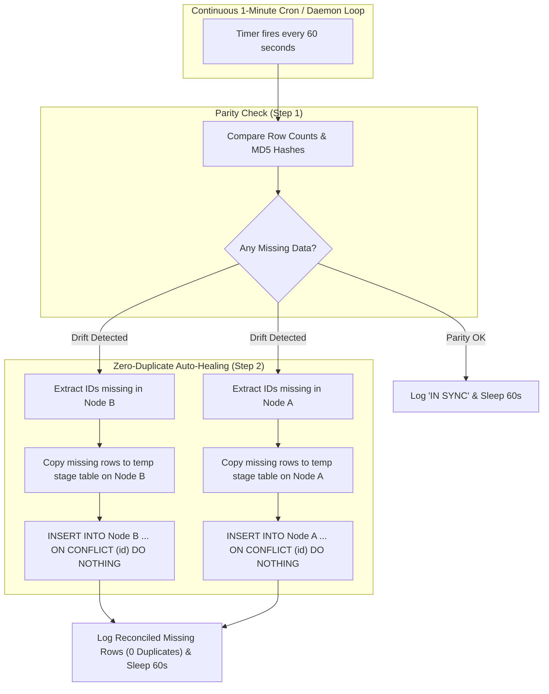

# Data Reconciliation & 1-Minute Auto-Healing Engine

## 1. Overview: Reconciling Missing Data Without Duplicate Entries

In an Active-Active multi-master cluster, replication lags, temporary network partitions, or transient connection dropouts can occasionally cause temporary data drift.

This project implements a **zero-duplicate, continuous 1-minute data reconciliation system**:
- **Reconciles ONLY missing records**: Computes exact set differences (`comm -23` / `comm -13` and `LEFT JOIN ... WHERE target.id IS NULL`).
- **Strictly ZERO duplicate entries**: All insertions use atomic staging tables with `INSERT INTO ... SELECT * FROM temp_stage ON CONFLICT (id) DO NOTHING`. Even under high-concurrency writes, duplicate key violations and duplicate rows are **100% prevented**.
- **Runs every 1 minute**: Operates continuously as a background daemon checking both databases every 60 seconds.



---

## 2. Preventing Duplicate Data ("ON CONFLICT DO NOTHING")

When importing missing records between Node A and Node B, rows are written into a temporary session table and injected into the target table using atomic upsert protection:

```sql
BEGIN;
CREATE TEMP TABLE temp_reconcile_stage (LIKE users INCLUDING ALL) ON COMMIT DROP;
\copy temp_reconcile_stage FROM 'data.tsv';

-- Inserts ONLY missing rows; skips any existing keys with ZERO errors
INSERT INTO users
SELECT * FROM temp_reconcile_stage
ON CONFLICT (id) DO NOTHING;

COMMIT;
```

### Relational Dependency Ordering
To respect foreign key constraints without constraint violations, tables are reconciled strictly in order:
1. `users` (Primary entities)
2. `orders` (References `users.id`)
3. `order_items` (References `orders.id`)

---

## 3. Running the 1-Minute Automated Daemon

### Option A: Automatic via Docker (Built-in)
The `reconciliation-service` container in [docker-compose.yml](file:///home/bariflo/Documents/PostgreSQL%20High%20Availability%20Project/docker-compose.yml) starts automatically with the cluster:
```yaml
reconciliation-service:
  image: postgres:16-alpine
  container_name: reconciliation-daemon
  entrypoint: ["/bin/sh", "-c", "sleep 10 && /reconciliation/reconcile.sh --daemon 60"]
  restart: unless-stopped
```

### Option B: Standalone CLI Daemon
You can run the daemon manually from the command line:

```bash
# Check and auto-heal every 60 seconds (1 minute)
./database/reconciliation/reconcile.sh --daemon 60
```

### Option C: One-Shot Manual Parity Check
```bash
# Check parity without modifying any data
./database/reconciliation/reconcile.sh --check

# One-shot reconciliation of missing rows (zero duplicates)
./database/reconciliation/reconcile.sh --fix
```

---

## 4. Sample 1-Minute Daemon Output

```
====================================================================
  PostgreSQL Active-Active Safe Reconciliation Engine (Zero Duplicates)
====================================================================
Node A: 192.168.1.10:5432/appdb
Node B: 192.168.2.20:5432/appdb
Mode:   --daemon

Running continuous reconciliation daemon every 60 seconds (1 minute)...

[2026-10-06 16:35:00] Running cross-database parity check...
  [users] Parity: IN SYNC (Rows: 142)
  [orders] Parity: IN SYNC (Rows: 85)
  [order_items] Parity: IN SYNC (Rows: 190)
[2026-10-06 16:35:01] Reconciliation cycle complete. All missing data reconciled with ZERO duplicates.
Sleeping 60 seconds until next check...

[2026-10-06 16:36:00] Running cross-database parity check...
  [orders] Drift detected! Node A: 85 rows | Node B: 87 rows
    Missing in Node A: 2 rows
    Missing in Node B: 0 rows
    Syncing missing rows into Node A (Zero duplicates guaranteed)...
    ✔ Node A updated: Reconciled 2 missing rows without duplicates.
[2026-10-06 16:36:01] Reconciliation cycle complete. All missing data reconciled with ZERO duplicates.
Sleeping 60 seconds until next check...
```
